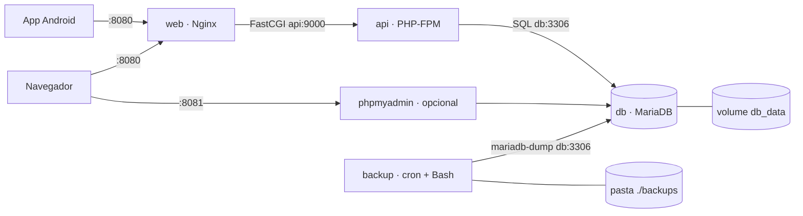

# Próxima Etapa · Ambiente Docker da API

**Cloud Native · Entrega 2: Containerização com Docker**
Grupo Tech Code · 3º ADS · FECAP 2026

Este projeto empacota a parte servidor do app **Próxima Etapa – App do Aluno** em containers: a API em PHP que o aplicativo Android consome, o banco de dados e o backup automático. O backup é o script Bash da Parte 1, que agora roda agendado dentro de um container próprio. Com um único comando, qualquer pessoa sobe o mesmo ambiente, sem instalar o XAMPP.

---

## 1. Arquitetura



`web` e `phpmyadmin` ficam nas duas redes (`rede_publica`, para publicar a porta, e `rede_interna`). `api`, `db` e `backup` ficam só na `rede_interna`, que não tem saída para a internet.

Versão em texto, caso o Mermaid não apareça:

```
 App Android / Navegador
          │  http://localhost:8080
          ▼
 ┌──────────────┐  FastCGI   ┌──────────────┐    SQL     ┌──────────────┐
 │ web (Nginx)  │──────────▶ │ api (PHP-FPM)│──────────▶ │ db (MariaDB) │◀── volume db_data
 └──────────────┘  api:9000  └──────────────┘  db:3306   └──────────────┘
                                                                ▲
                                     ┌──────────────────────┐   │ mariadb-dump
                                     │ backup (cron + Bash) │───┘
                                     └──────────────────────┘──▶ pasta ./backups
```

| Serviço | Imagem | Função | Porta no computador |
|---|---|---|---|
| `web` | própria (`web/Dockerfile`, base `nginx:1.27-alpine`) | Recebe as requisições e repassa os `.php` para a API | **8080** |
| `api` | própria (`api/Dockerfile`, base `php:8.3-fpm-alpine`) | Executa a API REST do app | nenhuma (só interna) |
| `db` | `mariadb:11.4` | Banco `proxima_etapa`, carregado com `db/init/01-banco.sql` | nenhuma (só interna) |
| `backup` | própria (`backup/Dockerfile`, base `alpine:3.20`) | Backup agendado com cron, rotação e log | nenhuma |
| `phpmyadmin` | `phpmyadmin:5.2` (opcional) | Ver as tabelas pelo navegador | **8081** |

**Por que MariaDB?** É o banco que vem no XAMPP, onde a API foi desenvolvida. É compatível com o MySQL e com a extensão `mysqli` usada pela API, então nenhuma linha de PHP precisou mudar.

---

## 2. Como os requisitos foram atendidos

| Requisito da entrega | Onde está |
|---|---|
| Dockerfile próprio, com imagem base enxuta, `.dockerignore` e camadas otimizadas | `api/Dockerfile`, `web/Dockerfile` e `backup/Dockerfile`, todos com base Alpine. Pacotes e extensões ficam numa camada antes do código, que muda mais. Cada pasta tem seu `.dockerignore`. A API roda como usuário `www-data`, não como root. |
| Pelo menos 2 serviços integrados pelo `docker-compose.yml` | 4 serviços (`web`, `api`, `db`, `backup`) e o `phpmyadmin` opcional |
| Volume para persistência | Volume nomeado `db_data` para o banco e pasta `./backups` montada no container de backup |
| Rede customizada / comunicação pelo nome do serviço | Redes `rede_publica` e `rede_interna`, esta com `internal: true`. O Nginx chama `api:9000`, a API e o backup chamam `db` |
| Variáveis de ambiente em `.env`, sem credenciais no código | `.env.example` como modelo, `.env` no `.gitignore`. A API lê `DB_HOST`, `DB_USER`, `DB_PASS` e `DB_NAME` com `getenv()` |
| README com arquitetura, build, portas e testes | Este arquivo |

Além do mínimo, o ambiente também tem:
- **healthcheck** no banco, no Nginx e no backup;
- `depends_on` com `service_healthy`: a API e o backup só sobem quando o banco está pronto;
- `restart: unless-stopped` em todos os serviços;
- `.gitattributes`, que garante quebra de linha LF nos scripts quando o repositório é clonado no Windows.

---

## 3. Estrutura

```
cloud-native/
├── docker-compose.yml        orquestração dos serviços, redes e volumes
├── .env.example              modelo das variáveis (copiar para .env)
├── testar.sh                 teste rápido do ambiente
├── api/
│   ├── Dockerfile
│   ├── php/producao.ini      PHP sem exibir erros e sem expor a versão
│   ├── php/zz-env.conf       libera as variáveis de ambiente para o PHP-FPM
│   └── src/proxima_etapa_api/  scripts da API (+ status.php para teste)
├── web/
│   ├── Dockerfile
│   ├── nginx/default.conf    rotas, /saude e repasse para api:9000
│   └── public/               página inicial e QR Codes de teste
├── db/init/01-banco.sql      estrutura e dados fictícios (carga inicial)
├── backup/
│   ├── Dockerfile
│   └── scripts/
│       ├── entrypoint.sh     agenda o cron e faz o primeiro backup
│       ├── backup.sh         dump + gzip + verificação + rotação + log
│       └── restaurar.sh      restaura o backup mais recente ou um escolhido
└── backups/                  onde aparecem os .sql.gz e o logs/backup.log
```

---

## 4. Como rodar

**Pré-requisito:** Docker Desktop (Windows ou macOS) ou Docker Engine com o plugin Compose (Linux).

```bash
# 1. Entrar na pasta
cd cloud-native

# 2. Criar o arquivo de configuração e trocar as senhas
cp .env.example .env          # no PowerShell: copy .env.example .env

# 3. Construir as imagens e subir
docker compose up -d --build

# 4. Acompanhar até tudo ficar "healthy" (cerca de 30 s na primeira vez)
docker compose ps
```

Com o phpMyAdmin junto:

```bash
docker compose --profile admin up -d --build
```

| Endereço | O que abre |
|---|---|
| http://localhost:8080 | Página inicial do ambiente, com links de teste |
| http://localhost:8080/proxima_etapa_api/status.php | Situação da API e do banco |
| http://localhost:8081 | phpMyAdmin (usuário `root` e a senha `DB_ROOT_PASSWORD` do `.env`) |

Para mudar as portas, edite `API_PORT` e `PMA_PORT` no `.env`.

### Usar com o app Android

O app já tem a opção de trocar o endereço da API. No emulador, abra **Perfil → Endereço da API** e informe:

```
http://10.0.2.2:8080/proxima_etapa_api/
```

Num celular físico, use o IP do computador no lugar de `10.0.2.2`. Para descobrir o IP, rode `ipconfig` e veja o Endereço IPv4. Faça login com `aluno@proximaetapa.org` e a senha `123456`.

---

## 5. Como testar

### 5.1 Teste automático

```bash
./testar.sh
```

Saída esperada:

```
Testando http://localhost:8080
  [OK]    Nginx respondendo
  [OK]    API conectada ao banco
  [OK]    Lista de cursos
  [OK]    Agenda da aluna 1
```

### 5.2 Teste manual (funciona também no PowerShell)

```bash
curl http://localhost:8080/saude
curl http://localhost:8080/proxima_etapa_api/status.php
curl "http://localhost:8080/proxima_etapa_api/agenda.php?alunoId=1"
curl -X POST -d "email=aluno@proximaetapa.org&senha=123456" http://localhost:8080/proxima_etapa_api/login.php
```

No PowerShell, use `curl.exe` no lugar de `curl`.

O `status.php` deve responder algo como:

```json
{"success":true,"status":"ok","banco":"db","cursos":16,"hora":"2026-11-09 22:30:00"}
```

### 5.3 Persistência (volume)

```bash
# Fazer um check-in pelo app (ex.: código PE-ENC-004) e depois:
docker compose down        # remove os containers, mas mantém o volume
docker compose up -d
# O check-in continua no banco: abra checkins.php?alunoId=1 ou o phpMyAdmin
```

`docker compose down -v` apaga também o volume. Na próxima subida, o banco volta ao estado inicial do `01-banco.sql`.

### 5.4 Rede isolada

```bash
# O banco não tem porta publicada: isto deve FALHAR
curl http://localhost:3306

# Dentro da rede, a API acha o banco pelo nome do serviço
docker compose exec api php -r "echo gethostbyname('db'), PHP_EOL;"   # mostra o IP do banco
```

### 5.5 Backup automático

Ao subir, o container `backup` já faz o primeiro backup e depois repete no horário de `BACKUP_CRON`, que por padrão é a cada 6 horas.

```bash
docker compose logs backup                # mensagens do agendamento e dos backups
ls backups/                               # arquivos proxima_etapa_AAAAMMDD_HHMMSS.sql.gz
cat backups/logs/backup.log               # log com data e hora

# Backup manual, mantendo só 3 cópias
docker compose exec backup /app/backup.sh -k 3

# Ajuda do script
docker compose exec backup /app/backup.sh -h

# Restaurar o backup mais recente (ou informar o nome do arquivo)
docker compose exec backup /app/restaurar.sh
```

Exemplo de log:

```
[2026-11-09 22:30:05] [INFO] Iniciando backup do banco 'proxima_etapa' em 'db' (mantendo 7 cópias)
[2026-11-09 22:30:06] [OK] Backup criado: proxima_etapa_20261109_223005.sql.gz (8.0K, 7 tabelas)
[2026-11-09 22:30:06] [INFO] Rotação: 0 antigo(s) removido(s). Backups guardados: 1. Espaço usado: 12K
```

O `backup.sh` confere o retorno de cada etapa e sai com códigos diferentes para cada problema:

| Código | Significado |
|---|---|
| 2 | parâmetro inválido |
| 3 | variável de ambiente faltando |
| 4 | banco fora do ar depois de 5 tentativas |
| 5 | falha no dump |
| 6 | arquivo corrompido |

---

## 6. Comandos úteis

| Ação | Comando |
|---|---|
| Ver os serviços e a saúde | `docker compose ps` |
| Ver logs de um serviço | `docker compose logs -f api` |
| Parar tudo | `docker compose down` |
| Parar e apagar o banco | `docker compose down -v` |
| Reconstruir depois de mudar o código | `docker compose up -d --build` |
| Entrar no banco pelo terminal | `docker compose exec db mariadb -u root -p proxima_etapa` |
| Tamanho das imagens | `docker images "proxima_etapa/*"` |

---

## 7. Problemas comuns

| Sintoma | Solução |
|---|---|
| `port is already allocated` na 8080 ou 8081 | Outra aplicação usa a porta. Troque `API_PORT` ou `PMA_PORT` no `.env` |
| `status.php` responde "Falha na conexão com o banco" | O banco ainda está iniciando. Espere o `db` ficar `healthy` em `docker compose ps` |
| Mudou a senha no `.env` e o banco não aceita | A senha é gravada só na primeira subida. Rode `docker compose down -v` e suba de novo |
| Container de backup reinicia com `bad interpreter` | Os `.sh` foram salvos com quebra de linha do Windows. O `.gitattributes` evita isso; se acontecer, converta para LF no VS Code (canto inferior direito) |
| App mostra "Modo offline" | Confira o endereço em Perfil → Endereço da API (com `:8080`) e se o `web` está `healthy` |

---

## 8. Segurança e dados

- Senhas só no `.env`, que não vai para o repositório. O código lê tudo por variável de ambiente.
- O banco não publica porta: só é acessível pela `rede_interna`, que não tem saída para a internet.
- O PHP roda sem privilégios de root e não exibe mensagens de erro nem a versão para quem acessa.
- No backup, a senha é passada por `MYSQL_PWD` e não pela linha de comando, para não aparecer no `ps`.
- Todos os dados do banco são fictícios (LGPD).
